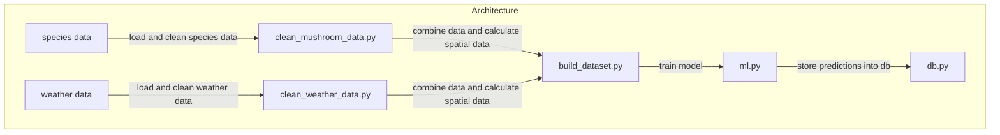

# findmushroom

This is data science project for helsinki universitys masters course. We wanted to make an application for predicting mushrooms and specifically where and when would be the optimal time to pick mushrooms. Our aim is to build a model that predicts growth of different mushroom species based on some weather data. The end product would be a website where users could select a mushroom and as a result the website would display a heatmap of Finland and different probabilities of finding said mushroom. Our users could be anyone who is interested in mushrooms or picking mushrooms. See more details [here](https://github.com/FungusLocus/findmushroom/wiki/Project-Overview)

### Installation
1. pull the repo ```git clone git@github.com:FungusLocus/findmushroom.git ```
2. go to the project root ```cd findmushroom```
3. create virtual enviroment ```python -m venv .venv``` (linux)
4. activate venv ```source .venv/bin/activate```
5. install requirements ```pip install -r requirements.txt```

### Running the app
1. ``` source .venv/bin/activate ``` 
2. ```uvicorn app.main:app --reload```

### Datasets used
[Mushroom data](https://laji.fi/en)

[Weather data](https://github.com/pnuu/fmiopendata)

### Database set up

1. Install [PostgreSQL](https://www.postgresql.org/download/)
2. Open pgAdmin
3. Connect to PostgreSQL with the username and password you made during installation
4. Create a new database
5. Open the query tool and execute the content of database/schema.sql

### Architecture



